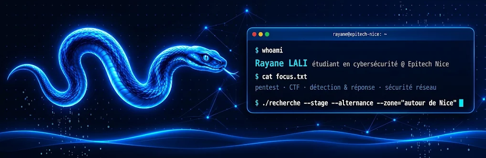

<p align="center">
  
</p>

<p align="center">
  <a href="https://rayane2l.github.io/portfolio/"></a>
  <a href="https://www.linkedin.com/in/rayane-lali"></a>
</p>

---

### `> about_me`

```yaml
name: Rayane LALI
school: Epitech Nice — Bachelor (2e année)
focus: [pentest, CTF, détection & réponse, sécurité réseau]
playing_on: [HackTheBox, CTF Epitech]
learning: [Active Directory, web exploitation, sécurité des LLM]
fun_fact: je construis aussi des robots Arduino 🤖
```

### `> ls ./cyber --featured`

| Projet | Description | Stack |
|---|---|---|
| [exegol-ctf-writeups](https://github.com/Rayane2L/exegol-ctf-writeups) | Write-ups de 12 machines Boot2Root du CTF Exegol (Epitech) : reconnaissance, exploitation, élévation de privilèges | Exegol · Nmap · Gobuster · Python |
| [owasp-juice-shop-writeups](https://github.com/Rayane2L/owasp-juice-shop-writeups) | 45 challenges OWASP Juice Shop : Broken Access Control, Injection, XSS, XXE, JWT… avec remédiation | Burp Suite |
| [hackthebox](https://github.com/Rayane2L/hackthebox) | Ma progression sur HackTheBox | Markdown |

### `> ls ./epitech`

| Projet | Ce que j'ai fait | Stack |
|---|---|---|
| **SentinelX** | Supervision et détection d'attaques sur une app de tickets. Mon rôle : volet cyber (Wazuh, règles de détection, plans d'attaque, runbooks, qualification d'alertes) | Wazuh · Docker · Prometheus · Grafana |
| **Codename** | Durcissement d'un agent LLM et boîte à outils de prompt injection | Ollama · Python |
| **Jobryx** | Moteur de recherche d'emploi tech. Mon rôle : backend et sécurité (JWT, RBAC, base de données) | TypeScript · Node.js · Docker |
| **Persona** | Newsletter personnalisée pilotée par un chatbot | n8n · IA générative |
| **TARDIS** | Analyse et prédiction des retards SNCF (Random Forest) + dashboard | Python · pandas · scikit-learn |
| **Mog Games** | Launcher et jeux 2D en Java orienté objet | Java |
| **eTodo** | Application fullstack de gestion de tâches | Node.js · Express · MySQL · Docker |
| **ELIZA** | Bot Discord coach fitness propulsé par un LLM local | Python · Ollama |
| **Bookworm** | Moteur NLP qui transforme des livres en fiches pour éditeurs | Python |

<sub>Les repos Epitech sont privés : je peux les présenter en entretien.</sub>

### `> ls ./perso`

| Projet | Description | Stack |
|---|---|---|
| [instagram-followback-checker](https://github.com/Rayane2L/instagram-followback-checker) | Extension navigateur 100 % locale, aucune donnée envoyée (privacy by design) | JavaScript |

### `> stack --list`

<p>
  
</p>

**Outils sécu :** Nmap · Burp Suite · Gobuster · Wireshark · Metasploit · John the Ripper · Wazuh · Exegol

### `> git log --graph`

<p align="center">
  <picture>
    <source media="(prefers-color-scheme: dark)" srcset="https://raw.githubusercontent.com/Rayane2L/Rayane2L/output/github-snake-dark.svg" />
    
  </picture>
</p>

<p align="center">
  
</p>
